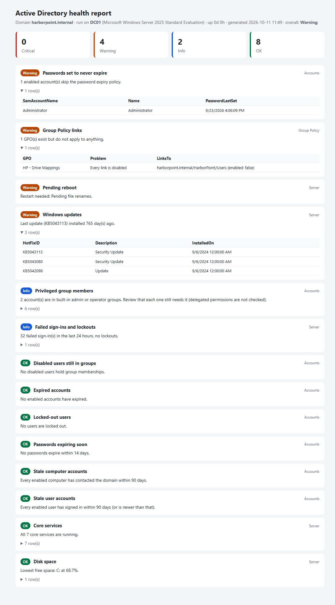

# AD Health Report

A read-only PowerShell script that checks a small Active Directory domain and saves the result as a single
HTML page. Problems are sorted to the top, so whoever opens the report sees what needs attention
first.



The screenshot is a real run against this [homelab's](../README.md) domain controller (`harborpoint.internal`). The raw HTML
is in [`sample/`](sample/AD-Health-2026-10-11.html). It flagged a real problem in the lab: the
*HP - Drive Mappings* GPO still exists, but its only link is disabled, so nobody gets their mapped drives.

## What it checks

| Area | Check | Flags |
|---|---|---|
| Accounts | Locked-out users | Warning if any account is currently locked out |
| Accounts | Expired accounts | Enabled accounts past their expiry date |
| Accounts | Passwords expiring soon | Expiring within 14 days, or already expired |
| Accounts | Passwords set to never expire | Enabled accounts that skip the expiry policy |
| Accounts | Stale users and computers | No sign-in for 90+ days (or never, if older than 90 days) |
| Accounts | Disabled users still in groups | Access that would come back if the account were re-enabled |
| Accounts | Privileged group members | Info: users in Domain, Enterprise and Schema Admins, Administrators, and Account, Server and Backup Operators (found by SID). Delegated permissions are not checked |
| Group Policy | GPO links | GPOs that are unlinked, have every link disabled, or have all settings disabled |
| Server | Core services | Critical if NTDS, DNS, Netlogon, KDC, W32Time or Server is stopped or missing, or DHCP Server is installed but stopped |
| Server | Disk space | Warning under 20% free, Critical under 10% |
| Server | Failed sign-ins and lockouts | Events 4625, 4771 and 4740 from the last 24 hours, grouped by account |
| Server | Pending reboot | Component servicing, Windows Update or pending file renames |
| Server | Windows updates | Warning if nothing has been installed for 45 days |

The script only reads. It changes nothing in AD or on the server. It needs the `ActiveDirectory` and
`GroupPolicy` modules and a reachable domain to start. After that, if one check fails (for example, no
permission), that check shows as Critical with the error and the rest of the report still runs.

## Requirements

- Run on a domain controller (the server checks describe the machine it runs on).
- Windows PowerShell 5.1 (tested on Windows Server 2025). PowerShell 7 has not been tested.
- An elevated session with an account that can read AD and the Security event log, such as a Domain Admin.
- The sign-in events only appear if auditing is on: failure auditing for Account Logon (4771) and
  Logon/Logoff (4625), and success auditing for Account Management, User Account Management (4740).

## Usage

```powershell
.\Get-ADHealthReport.ps1
# Report saved: C:\Scripts\Reports\AD-Health-2026-10-11.html (overall: Warning)
```

Every threshold is a parameter:

```powershell
.\Get-ADHealthReport.ps1 -OutputFolder C:\Reports -StaleDays 60 -PasswordWarnDays 7 `
    -DiskWarnPercent 25 -DiskCritPercent 10 -EventHours 48 -UpdateWarnDays 30
```

On the lab DC (2 vCPU, 4 GB RAM) a run took 44 to 55 seconds.

## Running it every morning

To have a fresh report each morning, register it as a scheduled task on the domain controller. I have not
run this step in the lab yet; the report itself was only run by hand.

```powershell
$action  = New-ScheduledTaskAction -Execute 'powershell.exe' `
    -Argument '-NoProfile -ExecutionPolicy Bypass -File C:\Scripts\Get-ADHealthReport.ps1 -OutputFolder C:\Reports'
$trigger = New-ScheduledTaskTrigger -Daily -At 7am
Register-ScheduledTask -TaskName 'AD Health Report' -Action $action -Trigger $trigger -User 'SYSTEM' -RunLevel Highest
```

Each day's report is saved as `AD-Health-<date>.html`, so older reports stay available for comparison.

## Notes

- `LastLogonDate` comes from `lastLogonTimestamp`, which domain controllers only update every 9 to 14 days.
  It is fine for finding accounts unused for months, not for "who signed in today".
- The built-in Guest, krbtgt and DefaultAccount accounts are skipped in the disabled-users check. They ship
  disabled and in default groups.
- Written with AI assistance and tested against my homelab domain controller.
